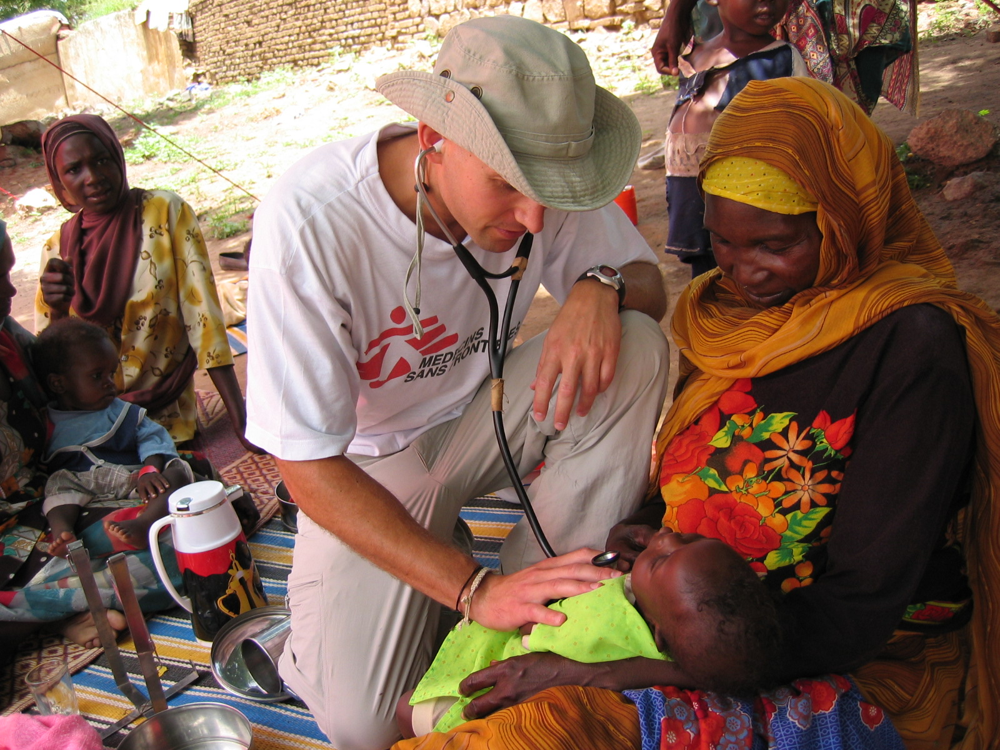

# How I created an e-portfolio

### Introduction:

These are the steps I took to create an E-portfolio on GitHub. An e-portfolio allows you to display your best work. The e-portfolio on my site is a resume format, but it can serve any purpose. For my current projects, I have been using Python in VS Code to create data visualizations like graphs and charts. Here is an image of something I recently did: 

Follow the steps below and you can create your own site too!\
*__Note:__* These instructions are for GitHub website, not desktop app. 

## *Step 1:*

Create a GitHub account. I already had one (NatCSMCC).

## *Step 2:*

Pick a theme through GitHub's pages. I am using the "Minimal," a Jekyll theme. There are many more themes, but Minimal is a simple one. This is the  to the theme and its source code:
Download the ZIP file then unzip and extract its contents.

[This is the link to view GitHub's various themes](https://github.com/pages-themes)

## *Step 3:*

Clone the repository from GitHub onto your computer OR find the local copy of your repository. Mine is "NatCSMCC.github.io". 

## *Step 4:*

On your GitHub repository, look at the README.md file. It has instructions from the Minimal theme to  help you change your website. Next, open the configuration file (_config.yml). Here, you can change information like the title, description, or even adding a photo to your site. Hit the edit button to change the code and the preview button will show how the markdown appears on the site. 

This is an image of Minimal's README.md file. When you clone your repository, your README.md will be the same as this. I changed mine later to show my portfolio information instead of the default minimal theme instructions.

My README.md:

## *Step 5:*

Add a headshot photo to your site by renaming the photo to something like "logo.png" on your computer then replace the photo in the "assets" file. You can also add more images in this file for elsewhere on the site. Replace the code in the config file to make sure the path and name of image is correct. Like this:

logo: /assets/img/logo.JPG

## *Step 6:*

To change the contents on your site, open the index.md file. You can replace the existing template. Since mine was resume format, I included my personal description, work and education history, and some personal/professional goals.

## *Step 7:*

You can use markdown features to change text to bold, italics, make ordered lists, create headers, include links, etc. 

[This is the link for the Markdown list on GitHub](https://docs.github.com/en/get-started/writing-on-github/getting-started-with-writing-and-formatting-on-github/basic-writing-and-formatting-syntax)

## *Step 8:* 

Save and publish by selecting the "Commit changes" button. Check if your website was successful by opening a new tab and typing your username.github.io

Success!

### *Tips:*
1. Refer back to the minimal theme instructions if stuck.
2. Commit changes regularly to save files manually.
3. Check if actions were successful in the actions tab.  

# Creating a subpage (optional)

## Introduction:

These are the steps I took to create a subpage on my site. A subpage is a nested site within your site. Someone viewing your GitHub site will be able to click the link and go to your subpage. You are looking at my subpage right now!

## *Step 1:*

Create a folder and give it a descriptive name (probably not "subpage_1"). Mine is "Portfolio_Steps". For this example, I named it "exampleFile". Add a backslash / after that name. It will create a file. Name that one index.md. Then, inside this folder, create a markdown file by clicking "new file" and calling it index.md

## *Step 2:*

Now, use markdown code to edit the file to include whatever you want. In this case, it is a step-by-step guide. You can include links and images in your subpage as well. Commit changes to save and publish. 

## *Step 3:*

Add a link to the subpage on your main site. To do this, open the index.md file and create a projects section in your markdown and add the link. It should look like a normal link format, but the link will be the name of the subfolder. For me, it is /Portfolio_Steps/ 

Then commit changes again.

## *Step 4:*

Check that everything works! Check your actions tab to see if they were successful. Then, visit your GitHub site and check to see if the changes took place. Locate the subpage then click on it and make sure it has all the info you included. 

_Et voilà!_
